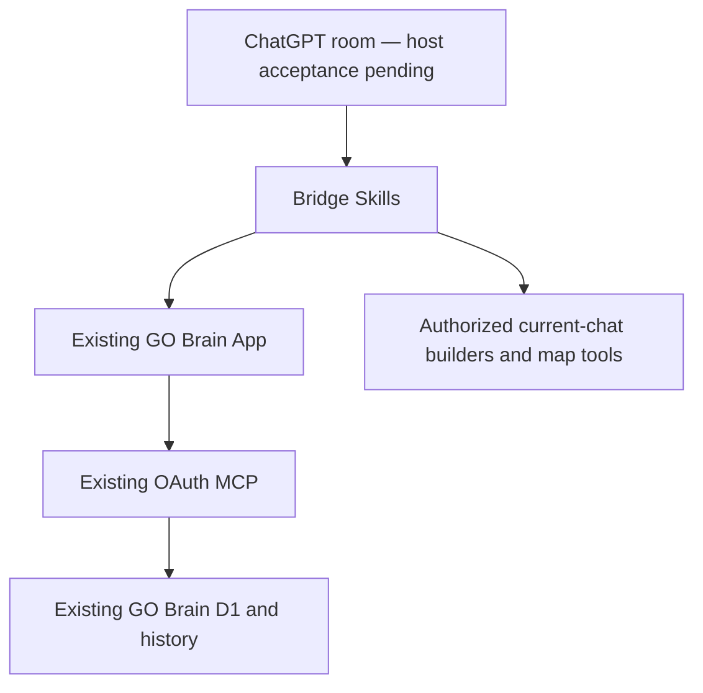

# Build evidence — 2026-10-14

This is an implementation snapshot, not a compatibility certificate. Re-test after connection, release or host changes.

| Capability | Artifacts | Executed checks | Runtime state |
|---|---|---|---|
| Website Builder | BUILT skill | Frontmatter/references TESTED | Publish-provider execution PLANNED |
| Web App Builder | BUILT skill and examples/task-smoke.html | Skill validation TESTED; Chromium launch failed because browser executable is absent | Interactive/rendering acceptance PLANNED |
| Maps & Routes | BUILT skill | Missing-provider discovery TESTED; no geographic provider returned in two searches | Real place/route/ETA tests PLANNED |
| Code Copilot | BUILT skill | Python builder executed; seven skills validated; sample JS syntax TESTED | Invocation via new plugin in ordinary chat PLANNED |
| System Architect | BUILT skill and architecture below | Existing README and schema inspected | API design review source-level TESTED; rendered Mermaid acceptance PLANNED |
| GO Brain Integration | BUILT verified existing App binding | Existing tools search/retrieve/save/edit/history/stale-revision/status/readback TESTED | Exact PANTHEON retrieval and test-record state VERIFIED in current Work Mode room only |
| Read/write separation | Workflow categories BUILT | Current host permission inspected; revision protection TESTED | Server-enforced separate read/write scopes PLANNED; source uses brain-owner |
| Ordinary ChatGPT Web | Acceptance procedure BUILT | No independent ordinary Web chat available for this test | PLANNED |
| ChatGPT Android | Acceptance procedure BUILT | No actual Android host/device control available | PLANNED |
| Mobile browser fallback | Existing authenticated GO Brain web UI source inspected | No actual-phone login/render test | PLANNED |

PANTHEON evidence: record a08908c4-8689-4ed5-a93d-5807fd842ef7 revision 1, updated 2026-10-14T03:57:00.984Z, retrieved through existing GO Brain. Source https://github.com/pureekangraw-ops/ygph-metropolis/pull/235 . Historical record reports draft implementation and incomplete backend deployment; no new assertion of live PANTHEON status.

Synthetic test record: 632343f5-5ae2-4bc0-b53f-59a1f5955aa1. Created revision 1 at 04:50:06.452Z, authorized edit confirmed by exact retrieval/history at revision 2 (04:50:14.978Z). Write response reported revision_conflict despite committed edit; readback proved commit. Explicit stale revision 1 write of STALE_WRITE_MUST_NOT_COMMIT was rejected; following retrieval preserved revision 2 and prior outcome. Archive response similarly reported revision_conflict; readback confirmed archived revision 3 at 04:52:25.601Z. Do not blindly retry uncertain mutations.

Existing plugin inspected: go-together-personal-brain 1.2.0, release pluginrel_6aca3da7c82c8191be8f075a435632e3. Existing GO Brain App: asdk_app_6aca401b8d848191a5aa1b5cc95f362a, verified from its stored .app.json. No existing plugin, Worker, auth scope or D1 changed. Host permission GO Brain: Allow all actions; not a claim of fine-grained OAuth authorization. Anonymous API probe returned HTTP 403 but network origin was not established, so it is inconclusive for authentication. Public dependency lookup failed because this is a private App; this is not an edit-access denial.

Other builder/map tools are not silently installed or bundled; their presence is checked per chat. No external Custom GPT API, Native APK, public data proxy, new agent or duplicate database is included. New plugin account creation, if successful, is separate from installation and Web/Android verification.
